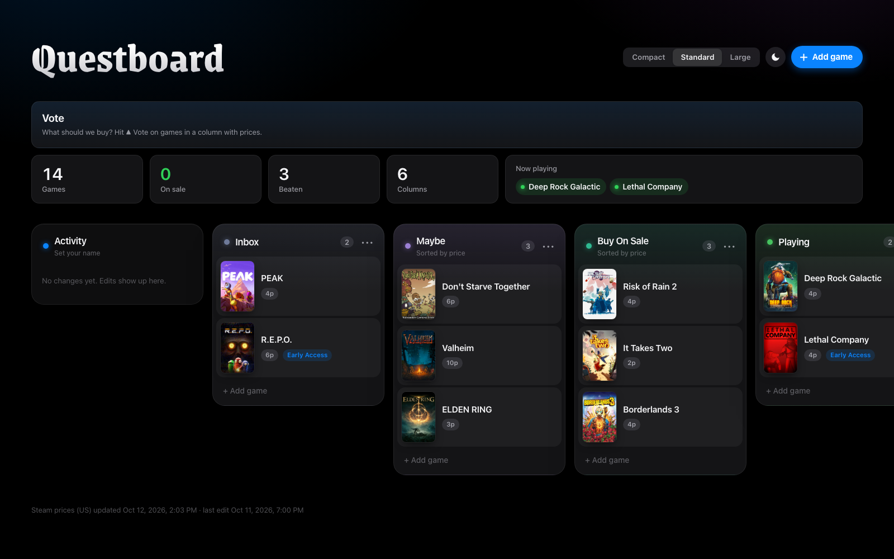

# Questboard



A shared co-op game backlog for a group of friends. It's a board of Steam games:
what you're playing, what's on sale, what you'll buy next, and what didn't
survive contact. It has live prices, Linux/Steam Deck warnings, and voting on
what to get. Everything runs as one small Cloudflare Worker on the free plan.

## What it does

- **Columns of games.** Drag cards between columns. Add a game by pasting a
  Steam link or app id, or by typing its name. Columns have names, colors and an
  optional sort by lowest price.
- **Live Steam prices** (US store), refreshed daily, with discounts. Games under
  $5 glow.
- **A Linux / Steam Deck warning** on games that might not run, from Valve's
  ratings and ProtonDB. Games that run show nothing.
- **Voting.** Each person gets one vote per game. A panel shows every voted
  game with its price and the total, and "New vote" starts a fresh round.
- **Activity.** A log of every change, with who made it. Visitors get a short
  anonymous tag, a keyed hash of their IP. Raw IPs are never stored.
- **Safe to edit.** Deleted cards go to a Trashed column you can restore from.
  Every save is kept for 30 days, a weekly snapshot is kept forever, and two
  people saving at once can't overwrite each other.
- Dark and light themes, and three densities.
- **Optional:** an API an AI agent can use to suggest games and fix titles (see
  [API](#api)).
- **Works on its own, or inside [Yap](https://github.com/yesokcool/yap)**, where
  it opens next to your voice chat with everyone's mouse pointer on it.

Editing uses one shared password, which is meant for a group of friends, not
strangers. For example, someone who changes their name could vote twice.

## Run your own

You need a free Cloudflare account and Node 22 or newer.

```sh
npm install
cp wrangler.example.toml wrangler.toml
npx wrangler login
npx wrangler kv namespace create GAMES_KV        # put the id it prints into wrangler.toml
npx wrangler secret put EDIT_PASSWORD             # the password your friends use to edit
npx wrangler secret put ACTIVITY_SALT             # any long random string: openssl rand -hex 32
npx wrangler kv key put board --path seed-board.example.json --binding GAMES_KV --remote   # a demo board to start from
npm run deploy
```

In `wrangler.toml`, either set your own domain in `routes` or set
`workers_dev = true` to use the free `*.workers.dev` address. To fill in prices
and covers right away, save any change on the board. Otherwise the daily refresh
does it.

### Settings

| Where | Name | What it does |
|---|---|---|
| `[vars]` in `wrangler.toml` | `BOARD_TITLE` | The name at the top of the page and in link previews. Default: Questboard. |
| | `BOARD_DESCRIPTION` | The link-preview text. |
| Secret | `EDIT_PASSWORD` | **Required.** The password for editing and voting. |
| | `ACTIVITY_SALT` | Recommended. The key for visitors' anonymous tags. Without it, Activity shows names only. |
| | `SUGGEST_TOKEN` | Optional. Turns on the agent [API](#api). |

**Icons and link previews (optional).** Put PNGs in KV and the page uses them:
`img:icon-64.png` (favicon), `img:icon-180.png` (home screen) and `img:og.png`
(1200x630, the image shown when the link is shared):

```sh
npx wrangler kv key put img:og.png --path og.png --binding GAMES_KV --remote --metadata '{"type":"image/png"}'
```

### Run it locally

```sh
npm run seed:local                               # the demo board, in a local database
npx wrangler dev --var EDIT_PASSWORD:test        # http://localhost:8787, password "test"
```

## Inside Yap

[Yap](https://github.com/yesokcool/yap) can show the board in its main pane,
with everyone's pointers drawn on top. Bind this Worker as `BOARD` in Yap's
config and list the board's paths. Yap's `SELF_HOSTING.md` (section "A board")
has the steps. The paths this board uses are:

```
^/(?:api/(?:board|login|votes|vote|vote/reset|steam-search)|img/[^/]+|thumb/[^/]+|favicon\.(?:svg|ico))$
```

## API

`GET /api/board` returns the board, the Steam cache, votes and activity.

With `SUGGEST_TOKEN` set, an agent (for example a weekly "find us new games"
run) can send `Authorization: Bearer <token>` to:

- `POST /api/suggestions` with `{"items": [{"title": "…", "steam": "<app id>", "why": "…"}]}`.
  Each game lands in the column named Inbox (or the first column) as a
  suggestion with Keep and Remove buttons. Games already on the board, or removed before, are skipped.
- `POST /api/tidy` with `{"updates": [{"id": "<card id>", "title": "…", "steam": ["<app id>"], "url": "…", "cover": "…"}]}`.
  This fixes titles and links cards that were added by name without a Steam
  match.

## License

[MIT](LICENSE). Use it, change it and run it for anyone; keep the license
notice with the code.
